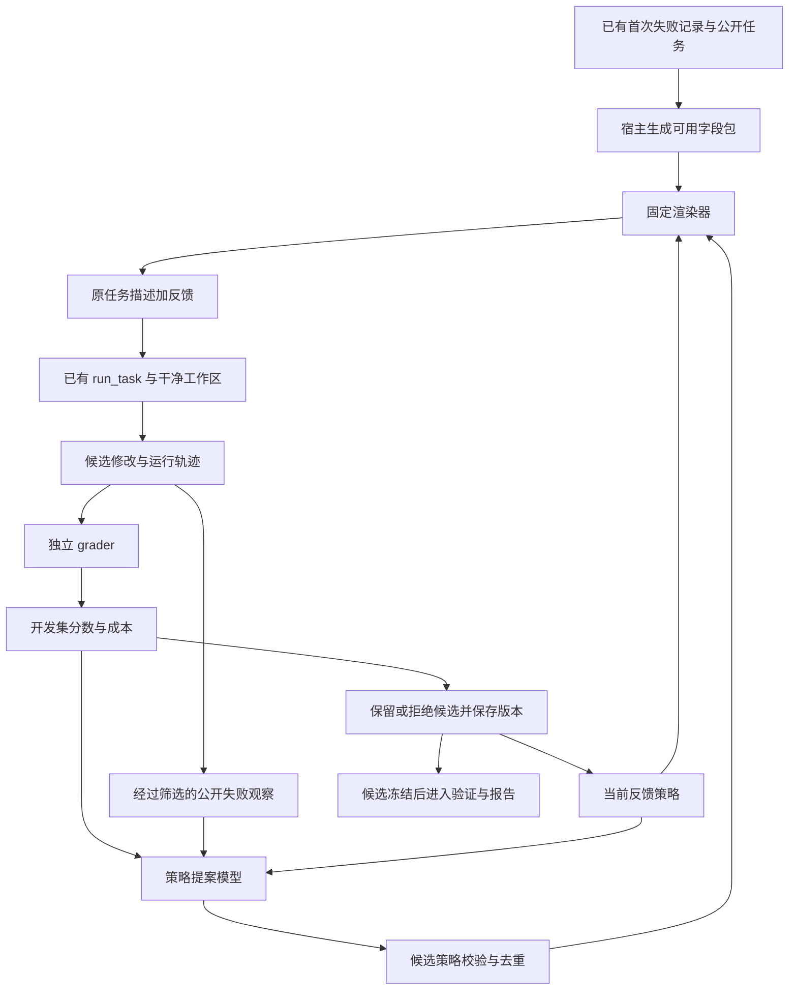

# 第一阶段快速版：失败反馈策略自优化

日期：2026-10-17。总体背景与协作分工见 [交接说明](RSI-HANDOFF.zh-CN.md)。

本文件提供目标、技术路线、工作顺序和阶段完成标准，供 Claude Code 制定具体计划。它不规定每个任务的修改文件、函数签名、执行命令或审批节点。以下建议规模应在检查当前环境后落实，不是已完成实验。

## 1. 第一阶段结束时要拿到什么

有一个可重复启动的小系统：读取已有首次失败记录，从固定反馈基线出发，调用提案模型生成有限个候选策略，运行真实修复任务比较它们，记录选择原因，进行下一轮更新，最终导出策略和完整报告。

用户能沿一条运行看到：原失败记录是什么、策略怎样变了、求解模型实际收到什么、为什么判定成功或失败、候选为何被保留或拒绝。

第一阶段的工程完成，不依赖“最后一定涨分”。若全部候选无效，保留固定基线并报告负面结果是正确行为。开发集上的最好成绩不等于新任务上的收益。

## 2. 把三个“模型角色”区分清楚

| 角色 | 做什么 | 能否在本阶段随意切换 |
|---|---|---|
| 开发助手 | Claude/Cursor 编写与审计项目代码 | 可以按任务选择；它的费用独立记录 |
| 策略提案模型 | 在系统运行时读取允许的开发材料，生成策略数据 | 一次搜索活动内固定型号与参数并记录；换模型另标活动版本 |
| 任务求解模型 | 在 Docker 工作区实际修复代码 | 同一组对照固定模型、参数、工具、环境与预算 |

独立 grader 是程序，不由上述模型投票判分。第一版不需要再加一个 LLM judge。

选择便宜的开发助手，不代表必须更换实验中的求解模型。沿用现有可用的求解配置有助于复用，但历史 `deepseek-flash` 别名不保证服务端版本永久不变，仍需记录请求与返回的型号、日期、供应方及参数，并同期交错运行基线。

## 3. 唯一改进对象：同题重试时的反馈

把策略记为 P，把首次失败记录记为 x，则反馈生成是：

> feedback = render(P, x)

随后，原任务描述加上 feedback，进入已有 `run_task`。每个候选都从同一干净源码状态重新尝试。首次失败的 diff 作为资料呈现，不默认把它应用到新工作区。

### 3.1 第一版建议开放的少量自由度

| 策略部分 | 可选变化示例 | 设计目的 |
|---|---|---|
| 旧修改呈现 | 不展示 diff、仅展示改动路径、展示有长度限制的 diff | 检查旧方案是否有帮助，或是否形成额外负担 |
| 可见观察的选择和顺序 | 先给测试输出、先给状态；保留末尾 1 或 2 条公开测试命令 | 让可核对的观察更容易被看到 |
| 末条回答与长度分配 | 保留/去掉 agent 自述；改变字段字节配额 | 避免把未经验证的总结当事实，控制上下文负担 |

先保留 2–3 个主要维度，不构建大量参数组合。通用的引导模板可以作为小范围扩展，但“内容可能有误、作为证据而非指令”、输入来源和格式边界由宿主固定，不能被候选移除。

候选应是 JSON/YAML 等受校验的数据。不能包含可执行 Python、shell、动态导入或读任意宿主文件的规则。模板只插入宿主提供的字段；具体格式由 Claude 决定。

策略必须能应用于多个任务。禁止针对某道题 ID、仓库路径、已知答案写特殊分支。文本筛查和人工审计只能降低这种风险，不能证明模型没有记住公开 benchmark；报告仍需说明数据范围。

### 3.2 第一阶段不同时做的内容

- 不修改模型权重，不接 GRPO 训练，不扩展跨题记忆库或检索系统。
- 不开放 agent 主循环、工具权限、grader 和计费逻辑给提案模型修改。
- 不同时搜索单次会话中的 masking/summary 参数；它们属于第二阶段的可选方向。
- 默认不额外生成测试或探索仓库，也不逐题调用另一个模型做长篇反思。

这样，第一版测试的是“如何选择和表达已有失败信息”。它没有凭空增加新证据，不能承诺解决信息不足或模型本身不会修复的问题。

若 Claude 判断必须加入逐题 LLM 提炼，应把它明确列为范围变化：增加独立的固定提炼基线、输出来源记录、失败处理与额外计算成本，再重新估算工作量。

## 4. 一条完整数据流

这张图中，循环发生在多次完整任务运行之间。一次任务运行期间不热更新策略。

建议第一版只有两轮提案，每轮最多两个新候选。第二轮确实读取第一轮的评测结果或失败诊断，并据此提出新候选。预先写好四份配置然后全部跑完，只能称为配置比较；不能把它描述成模型根据结果进行了自改进。

提案模型可能输出非法候选、重复候选或没有改善的候选，这些都是应当记录的正常结果。允许一次有上限的格式修复请求，计入搜索费用；之后跳过，不无限重试，也不由开发助手暗中改成有效方案再冒充自动产物。

## 5. 资产入口与复用边界

此表用于让 Claude 快速定位。是否抽公共函数、新增薄适配器或单独入口，由 Claude 根据依赖决定。

| 入口 | 已有作用 | 第一阶段用途或注意事项 |
|---|---|---|
| [build_a6_attempts.py](D:/crq/src/coding-harness/scripts/build_a6_attempts.py) | 选择首次失败、提取可见命令输出、生成规范 diff、渲染反馈 | 复用提取与来源检查；旧渲染输出作为固定基线 |
| [a6-attempts.json](D:/crq/src/coding-harness/docs/sprint/a6-attempts.json) | 53 份记录、22 道题及 hash | 输入清单；保留旧文件，生成新的子集/活动清单 |
| [run_a6_retry.py](D:/crq/src/coding-harness/scripts/run_a6_retry.py) | 打乱槽位、重试运行、注入验证、收集结果 | 复用设计；有固定 R0/R1、数量、路径和金额，不能直接换名字就作为通用优化器 |
| [run_swe_task.py](D:/crq/src/coding-harness/scripts/run_swe_task.py) | `build_prompt` 与 `run_task(..., prompt_suffix=..., retry=...)`，执行及评分 | 现成的反馈接入口；注意其旧 holdout 拒绝规则，不能为新评测直接删除 |
| [b0-v2.yaml](D:/crq/src/coding-harness/configs/sprint/b0-v2.yaml) | A5/A6 运行配置 | 初始参考；正式比较采用同一份明确版本的配置 |
| [image_grader.py](D:/crq/src/coding-harness/src/eval/image_grader.py) 与 [baseline_image_backend.py](D:/crq/src/coding-harness/src/execution/baseline_image_backend.py) | 干净环境与独立评分 | 继续使用；不为了方便提案模型而暴露 grader 私有材料 |
| [model_budget.py](D:/crq/src/coding-harness/src/policy/model_budget.py) 与 [cny_budget.py](D:/crq/src/coding-harness/src/policy/cny_budget.py) | 已有预算和计费机制 | 借鉴或复用；新增活动级搜索成本，不假定各账本天然已统一 |
| [analyze_a6_retry.py](D:/crq/src/coding-agent/scripts/analyze_a6_retry.py) 与 [a6_diff.py](D:/crq/src/coding-agent/scripts/a6_diff.py) | 按题统计及 diff 处理 | 借鉴指标计算；冻结分析脚本不改成适配新结果的版本 |
| [window.py](D:/crq/src/coding-harness/src/runtime/window.py)、[summary.py](D:/crq/src/coding-harness/src/runtime/summary.py) | 单次运行上下文管理 | 后续扩展入口；本阶段默认保持既有行为 |

第一阶段主要代码与新产物放在 coding-harness，避免再建立一套跨仓编排。coding-agent 的旧分析和报告只读引用；若确有跨仓改动必要，由 Claude 说明依赖。

新增范围应集中在：失败信息适配、策略表示与渲染、提案与候选校验、搜索编排、结果选择与报告。优先使用现有 runner，不重建一套工具和执行引擎。

## 6. 数据边界：谁能看到什么

### 6.1 反馈渲染器

只接收允许的首次失败信息：原任务、原始源码、首次尝试修改、当时 agent 可见的命令输出、停止状态，以及该次提交未通过的一个结果位。

不能把整个 `summary.json` 或整份宿主结果对象直接传给模型。当前 summary 除了可用字段还包含 grader 相关字段；要构造白名单视图。

A6 的构建脚本也有宿主泄漏检查，后者会读取私有材料。可以复用这项检查，但不得把检查器的私有输入、具体隐藏测试信息或匹配原文带入模型上下文。

### 6.2 策略提案模型

可以读取当前通用策略、开发集上候选的分数/费用/失败类别，以及选定的公开轨迹片段。选择这些片段的方式需要可复现，不能只挑符合预期的案例。

不能读取 gold patch、隐藏测试正文、隐藏测试诊断细节、保留集轨迹或保留集结果。开发集 solved 布尔和汇总分数可以驱动优化；它们来自宿主评分，不需要把评分器内部材料传出来。

### 6.3 验证与保留检查

验证程序可以使用独立 grader 的输出选择候选，但最终输出策略前，验证结果不再回灌提案循环。若根据验证失败继续改策略，这批数据就变成了开发材料，需要另设下一次验证。

这些边界靠程序的数据通路与文件权限实现，不能只在提示词里写“不要看答案”。开发助手读过旧报告，也意味着旧题无法重新获得真正未见的地位。

## 7. 对照与数据安排

### 7.1 三个固定基线加自动选出的策略

| 组 | 定义 | 用途 |
|---|---|---|
| N：无反馈 | 与 R0 对应，同一任务从干净状态重试 | 检查增加反馈本身是否值得 |
| R：原始记录 | 按原 A6 R1 的冻结方式注入 | 检查新方法相对旧失败记录的变化 |
| H：人工结构化策略 | 搜索前固定的一份简洁策略，由公开观察组织反馈 | 检查收益是否仅来自人工整理 |
| E：自动选择结果 | 从 H 出发经候选评测选出的策略；可能最终仍是某个固定基线 | 检查自动搜索额外带来了什么 |

R 的原记录已有 8192 字节上限，不是无限原始日志。H 和候选使用相同最大反馈长度规则；R 保留其原始定义。实际长度作为结果报告，不能只报上限。

H 可以优先展示可见测试观察与已修改路径，减少未经验证的最终自述；具体内容由 Claude 在搜索前固定。不要在看到自动候选成绩之后把 H 改弱。

如果 E 等于一个固定基线，直接复用该策略的同批验证结果，明确没有找到新的更优策略，不另起一个名字制造提升。

### 7.2 低成本起步建议

现有 22 道 A6 题可用于第一阶段。建议按 task 划分，而不是把同题的不同首次失败分散到不同集合。一个可执行的初始规模是：

| 用途 | 建议规模 | 数据如何使用 |
|---|---:|---|
| 搜索开发 | 8 道旧题 | 提案模型可读允许的轨迹与得分；两轮搜索 |
| 候选选择 | 6 道旧题 | 冻结候选后统一比较，不再用于提案 |
| 旧题保留回归 | 剩余 8 道旧题 | 最终策略确定后检查一次，不参与选择 |

这三部分全部来自已分析过的历史题，只是本次活动中的分工。第三部分也不能标成“全新 holdout”或作为强泛化证据。

为了快速版，每道题先按固定规则选一个首次失败，例如现有记录中编号最小者，避免凭失败内容挑选。各组共用这份首次失败，同题所有材料留在同一集合。划分规则和随机种子写入活动清单，并尽量兼顾不同仓库；不要按“哪组更容易出正结果”分配。

若已有可运行且未参与此前分析的新题，可以用它们替换保留回归；但要先核对题源、环境、首次失败的生成方式及答案隔离。新题获取和环境适配若成为主要工作，放到第二阶段，不拖住闭环原型。

### 7.3 旧数据复用的正确方式

可以直接复用首次失败资料。对新策略的效果则需要重新执行任务；仅回放旧 trajectory 无法知道换了反馈后模型会怎样行动。

同一活动里的基线和候选应同期交错运行，使用同样的初始源码、求解模型、工具、grader、上下文设置和预算。不能把今天 E 的结果直接减去九月/十月旧报告的 R0 数字，作为本轮提升。

## 8. 搜索、选择与停止

建议采用以下足够小的流程：

1. 固定 N/R/H，准备数据与环境，运行少量接线 smoke。
2. 在搜索开发集上运行基线；提案模型读取 H 和允许的开发反馈，提出最多两个候选。
3. 对候选校验、去重，在相同开发任务上评测。按预先固定的规则保留当前最好版本，同时保存所有拒绝记录。
4. 第二轮读取第一轮结果，再提出最多两个候选并评测。基线和父版本的评测槽位可按版本身份复用，不为增加次数重复付费。
5. 冻结最多两个开发候选，与 N/R/H 在候选选择集上同批比较。之后不再调整候选内容。
6. 从已比较的策略中确定最终版本；没有候选满足选择规则就保留固定基线。对最终结果进行一次保留回归并生成报告。

提案模型解释“为什么它可能有效”，只能作为候选动机；不能代替测量，也不能给自己评分。

### 选择规则的方向

主目标是实际修复成功率。先比较按题聚合的成功率，再在预设的近似持平条件下比较成本或长度；同分默认保留旧版本，避免无意义更新。具体阈值由 Claude 在看本轮结果前确定。

不要直接用一个未解释的“成功率 − λ×成本”分数掩盖更差的成功率。若只在成功率持平时成本更低，报告成本收益，不能写成修复能力提高。

开发集选优允许有噪声，选出的是本轮候选。小验证集也不能证明统计显著性；是否需要更多重复或第二阶段新题，应由实际不确定性决定。

### 停止与失败处理

- 两轮结束、候选额度耗尽或活动预算耗尽时停止，不为了追到正结果自动扩大搜索。
- 发生答案隔离、实际注入不一致、评分器异常或版本身份混用时，先修复基础问题，不能把这种结果算作策略表现。
- 模型解析失败、上下文溢出和用尽预算不能因为对某策略不利就删掉；基础设施错误与任务失败的分类和重试规则需明确。
- API 余额不足、网络失败等重试应保留原槽位和费用。恢复不能重复扣费后把旧请求当作不存在。

新编排应支持已完成槽位复用与安全停止；已有 Docker 会话恢复的限制仍然存在，不要求第一版完成任意中断点的透明恢复。

## 9. 指标与成本

### 9.1 结果至少回答这些问题

主指标是在选定首次失败条件下的重试成功率，不是整个 SWE-bench 的 pass@1，也不是从零开始的两次尝试总成功率。后两者需要另行定义样本和完整计算成本。

- 同一批题上，N/R/H/E 各解出多少题、多少次？主比较按 task 等权聚合。
- E 相对 H 和 N 分别变化多少？改善是否只来自某一道题或某一个仓库？
- 总调用量、实际 token、估算费用、运行时间分别是多少？有哪些 usage 未知？
- parse_error、context_overflow、预算耗尽、基础设施错误分别多少？
- 反馈实际长度、旧 diff 重复程度如何变化？这些作为解释性指标，不代替成功率。

若每题有多个首次失败或多个重复，不能把所有运行当作独立任务扩大样本量。小规模快速版可以先报告逐题表、差值与波动；区间若提供，应按题处理相关性。

### 9.2 分开记三笔费用

1. 开发助手的编码和审计费用：项目开发成本。
2. 离线策略搜索：提案模型、候选任务运行、验证和失败重试费用。
3. 选定策略实际部署后的单次任务成本：本版以固定渲染为主，没有额外的逐题反思模型调用，但注入文本会增加求解输入。

已有首次失败数据作为存量资产可复用；若讨论从零部署的完整成本，还应说明首次尝试的成本，不能当作凭空免费获得。

默认仍可沿用每次求解最多 40 次调用的起点，但它不等于本项目总预算。还需要限制候选数、提案调用、任务槽位及活动总花费。价格从运行时有效配置核对，记录估算与实际账单的区别，不沿用过期价格常量。

### 9.3 建议规模的数量估算

以两轮、每轮两个新候选为上限，一共最多四个候选：

| 部分 | 每题一次的探索规模 | 验证/回归各两次的扩展规模 |
|---|---:|---:|
| 开发：8 题 ×（3 基线 + 4 候选） | 56 | 56 |
| 选择：6 题 ×（3 基线 + 最多 2 候选） | 30 | 60 |
| 保留回归：8 题 ×（3 基线 + 最终策略） | 32 | 64 |
| 合计任务重试运行 | 最多 118 | 最多 180 |

此外预留少量接线 smoke，例如 2 题 × 4 种反馈，共 8 次；提案请求单独计数。无效/重复候选不需要启动全批评测，E 与某基线相同也不需要重复运行。格式修复和基础设施重试可能增加请求和费用，必须有自己的上限。

历史 A6 每次运行均值约 0.50–0.59 元，只能作为粗略量级参考。按 118–180 次计算约为 59–106 元，尚未包括上述新增费用与环境开销；当前实际花费可能明显不同。先用 smoke 测当前单次成本，再确定活动金额，不把这个算例当报价或授权额度。

单次重复是探索用途；若要在面试中讨论稳定收益，应补重复或进入第二阶段，而不是把一次成功描述成确定提升。

## 10. 建议的实施顺序

这里是工作流，不是逐项编码合同。Claude 可据实际代码进一步拆分。

| 工作段 | 解决的问题 | 应得到的可检查产物 |
|---|---|---|
| A. 现状与环境核对 | 旧输入是否可读、环境是否能跑、哪些入口带有旧实验限制 | 资产清单、当前版本、环境问题与最小接线方案 |
| B. 反馈策略与固定基线 | 策略到底能改什么，怎样映射到模型输入 | N/R/H、策略数据格式、渲染前后示例、来源关联 |
| C. 最小闭环 | 一条记录经候选策略是否真的完成独立评分 | fixture 演示和少量真实 smoke；实际注入校验与费用记录 |
| D. 自动提案与版本选择 | 能否依据结果做第二轮更新，并拒绝坏候选 | 两轮搜索、候选历史、选择原因、可恢复槽位与预算停止 |
| E. 小规模比较与交付 | 结果是否可解释、用户是否能独立跑起来 | 对照表、成本、失败案例、启动说明、阶段总结 |

先用离线 fixture 验证控制流，尤其拒绝非法候选、全部候选退化、同分保留旧版和预算停止。合成分数只证明这些分支正确；真实修复效果只能由实际任务运行验证。

第一轮只跑少量真实样本检查接线和账单，再运行选定规模。不要在读入、注入、评分和费用尚未对齐时直接启动全部任务。

在已有环境可用的前提下，预计约 20–40 小时有效开发、约 1–2 周日历时间；包括集成、少量运行、问题修复与说明文档，不包括保证产生正收益。新题镜像准备或大范围运行时重构会超出这一估算。

如时间紧，优先保留完整链路、三个固定基线、第二轮使用第一轮结果、失败保留和清楚的演示。可以减少候选与样本，不应删掉无反馈/人工基线，或只展示最好的一次。

## 11. 产物与可复现要求

不强制文件名，但一次活动至少能找到：

| 产物 | 需要说明什么 |
|---|---|
| 活动清单 | 代码版本与未提交 diff、数据分工、模型与参数、预算、价格、随机顺序 |
| 策略版本 | 策略内容、hash、父版本、生成方式、提案输入与输出、合法性检查 |
| 反馈实例 | 来源记录 hash、策略 hash、渲染内容、长度、实际发给模型的 prompt/view |
| 逐运行结果 | 任务与首次失败身份、重复编号、输出目录、评分、失败分类、用量及费用 |
| 选择历史 | 哪些候选被拒绝、为何保留当前版本、验证集何时启用 |
| 最终报告 | 全部分母、N/R/H/E 比较、成本、局限、代表性失败，不只保存成功案例 |
| 用户教程 | 从启动到看轨迹的实际命令和路径、一次完整示例、怎样复用最终策略 |

运行身份至少绑定 task、首次失败、策略、代码/配置、模型参数和重复编号。恢复或缓存时校验这些身份，不能因为目录名一样就复用结果。

建议每次活动写新目录，原 A5/A6 和 R2 归档保持只读。最终策略以明确版本导出，仍可切回固定基线；不能只在对话中留下“推荐使用某配置”。

## 12. 第一阶段完成标准与大阶段复核

### 工程完成

- 存在一条真实链路，能从首次失败资料走到新策略、任务重试、独立评分与结果记录。
- 至少两轮提案有因果上的数据联系；所有候选及拒绝原因可查，不能手动挑好候选伪装自动搜索。
- N/R/H 同批比较，策略实际注入得到验证，候选无法改变评分依据。
- 能处理非法提案、重复提案、无改进和预算停止；旧版可保留，最终策略可导出和复用。
- 用户有明确的启动、查看轨迹与阅读报告入口，并能解释一条完整运行。

### 效果结论

- 若 E 优于 H 和 N，报告具体任务范围、样本量、重复数与成本；旧题结果只支持当前范围。
- 若 E 只优于 R，却不优于 N/H，说明修正了旧反馈的一部分问题，但未证明自动优化具有额外收益。
- 若仅降低费用，按成本改善描述；若无改善，保留基线并报告负面结果。
- 若只能跑通 fixture 或 smoke，标为闭环原型，不标为完成了有效性评测。

阶段结束时给 Codex 的材料可以保持简短：目标和实际范围、代码版本与入口、Claude 的审计摘要、主要结果与费用、一个可追踪样例、未解决问题。Codex 检查的是方向是否跑偏、工程证据是否完整、效果表述是否超过证据，不重新接管每个开发任务。

## 13. 留给 Claude 的主要设计决策

Claude 接手后自行决定策略格式与模块布局、最少自由度、数据划分的确定方式、预算接入、候选选择阈值和详细测试安排。以上有默认建议，通常无需逐项回到本对话确认。

需要重新说明范围的变化包括：从通用配置变为逐题 LLM 反思、从反馈优化变为任意源码修改、同时更换求解模型或评分器、把旧题结果用于新任务泛化声明。它们会改变我们实际要回答的问题。

最终期望：第一阶段交付一个作者能运行、能解释、能查证的反馈策略优化系统；是否继续扩大搜索或走向策略代码自修改，再由这一阶段的结果决定。
