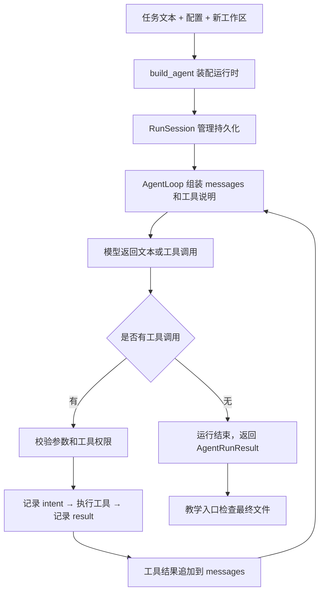

# coding-harness：从第一次运行，到把轨迹对应到代码

适用目录：`D:\crq\src\coding-harness`。命令使用 **Windows PowerShell**。2026-10-15 在这台机器实测。

你现在不需要从头读源码。先运行一个只有两行代码的修复任务，看到它经过哪些模块、生成什么文件，再打开这些模块。第一遍只完成第 1～3 节，约 30～45 分钟；恢复机制和扩展功能留到第二遍。

## 0. 这次到底会运行什么

任务：把 `calc.py` 里的 `return a - b` 改成 `return a + b`。


| 部分               | 本教程如何运行                                         |
| ---------------- | ----------------------------------------------- |
| 模型               | 固定回复的测试替身；按照预设顺序发出工具调用，不访问 API                  |
| 配置装配、AgentLoop   | 项目现有实现                                          |
| 工具参数校验、读文件、改文件   | 项目现有实现，实际读写新建的小工作区                              |
| 会话、事件存储、预算、trace | 项目现有实现                                          |
| 最终检查             | 教学脚本比较文件内容是否与预期一致；**不是 SWE-bench 判分，也没有执行隐藏测试** |


固定模型的意义是让每次输出一致，方便跟踪。它不会证明真实模型有修复能力。后面会指出换成真实模型后，调用链在哪儿接上。

本教程增加的入口是 [tutorial_walkthrough.py](../../scripts/tutorial_walkthrough.py)，配置是 [tutorial.yaml](../../configs/tutorial.yaml)。核心代码没有为教程另写一套。

## 1. 第一次运行：逐条复制，不需要配置 API


### 1.1 找对终端和 Python

打开 PowerShell，先执行：

```powershell
Set-Location D:\crq\src\coding-harness
.\.venv\Scripts\python.exe --version
```

实测为 Python 3.13.9。这里显式使用项目的 Python，所以不用先激活环境，也不用管系统里有几个 Python。

### 1.2 跑一个修复任务

```powershell
.\.venv\Scripts\python.exe scripts/tutorial_walkthrough.py run --case fix
```

你会看到类似输出；时间和随机目录名每次不同：

```text
RUN_DIR=D:\crq\src\coding-harness\runs\tutorial-harness\时间-fix-随机串
CASE=fix
MODEL=scripted (no network / no GPU)
  model round 1: ['read_file']
  model round 2: ['search_replace']
  model round 3: ['read_file']
  model round 4: [final answer]
```

后面 JSON 中先只看五项：

```json
{
  "runtime_success": true,
  "teaching_check_passed": true,
  "model_rounds": 4,
  "tool_calls": 3,
  "tool_failures": 0
}
```

它们分别表示：循环正常结束；最终文件通过教学检查；问了模型四次；实际调用工具三次；工具失败零次。最后一轮只有自然语言回复，所以四轮不等于四次工具调用。

### 1.3 亲眼查看改动

```powershell
.\.venv\Scripts\python.exe scripts/tutorial_walkthrough.py show files
```

应当看到：

```text
BEFORE:
def add(a, b):
    return a - b

AFTER:
def add(a, b):
    return a + b
```

现在你已经完成了一次真实的“工具读文件 → 工具改文件 → 保存结果”。被改的是新建工作区里的 `calc.py`，不是项目源码。

### 1.4 查看轨迹和文件夹

```powershell
.\.venv\Scripts\python.exe scripts/tutorial_walkthrough.py show flow
.\.venv\Scripts\python.exe scripts/tutorial_walkthrough.py where
```

`show flow` 展示输入、每步工具调用、工具结果、最终文件和检查结果。内容来自本次运行，不是预先写好的示意图。

想在资源管理器里看文件，执行：

```powershell
$tutorialDir = .\.venv\Scripts\python.exe scripts/tutorial_walkthrough.py where
Invoke-Item -LiteralPath $tutorialDir
```

每次 `run` 都新建一个目录。`show`、`turn`、`where`、`replay` 默认查看**最近一次普通教学运行**；旧目录仍然保留。后面运行失败案例后，默认查看对象也会改变。

## 2. 一轮究竟发生了什么：先看数据，再看源码


### 2.1 把一次运行画出来




这张图里的“模型”在教程中是替身，其他主干使用现有实现。模型提出 `read_file`，真正打开文件的是 Python 工具；模型提出 `search_replace`，真正写盘的也是工具。

### 2.2 打开第二轮：它怎么知道第一轮读到了什么

确认最近一次是 `fix`，然后执行：

```powershell
.\.venv\Scripts\python.exe scripts/tutorial_walkthrough.py turn 2
```

这里只显示第二次调用的输入和返回，不重复列出长工具说明。完整说明在 `requests.json`。

在 `request_messages` 中按顺序找：

1. `system`：项目给模型的工作规则。
2. `user`：本次修复任务。
3. `assistant.tool_calls`：上一轮要求 `read_file(path="calc.py")`。
4. `tool`：读到的 `return a - b`。`tool_call_id` 把它和上面的调用对应起来。
5. 可能还有预算提示，如 `remaining model calls`；这是 harness 加进来的。

再看 `response.tool_calls`：

```json
{
  "name": "search_replace",
  "arguments": {
    "path": "calc.py",
    "search": "return a - b",
    "replace": "return a + b"
  }
}
```

这是要求执行工具的结构化数据。它还不是“文件已修改”的证据。下一步 `SearchReplaceTool.execute` 真正执行后，才会得到 `ToolResult`。

注意两种表示：模型客户端返回的内部 `ToolCall.arguments` 是字典；加入 OpenAI 格式的消息历史时，`function.arguments` 是 JSON 字符串，所以会看到反斜杠转义。数据内容没有因此多出一层工具。

### 2.3 打开第三轮：改文件的反馈怎么传回来

```powershell
.\.venv\Scripts\python.exe scripts/tutorial_walkthrough.py turn 3
```

这次输入中多了一对消息：第二轮的 `assistant.tool_calls` 和对应的 `tool` 返回。模型现在能看到替换是否成功。第三轮再读文件，是脚本预设的一次复查。

这里说的“轨迹”是可记录的消息、工具调用、工具结果和状态，不是模型未输出的内部思考。

### 2.4 不要把四类文件混在一起


| 文件，均在 `where` 指向的目录下                          | 谁产生                   | 里面是什么                           | 用来回答什么      |
| --------------------------------------------- | --------------------- | ------------------------------- | ----------- |
| `task.txt`、`config.json`                      | 教学入口                  | 本次任务和解析后的配置                     | 本次究竟给了什么输入  |
| `workspace/calc.py`                           | 工具读写                  | 实际候选代码                          | 最终改成了什么     |
| `requests.json`                               | 模型替身旁的记录器             | 每轮实际收到的 messages、工具 schemas、返回值 | 模型当时看见什么    |
| `trace.jsonl`                                 | 教学入口导出真实 `StepRecord` | 一行一步，含调用与结果摘要                   | 循环执行顺序是什么   |
| `traces/`                                     | 现有 `TraceLogger`      | 项目原生 step/run 日志                | 原来的日志设施如何记录 |
| `session/events.sqlite3`、`session/artifacts/` | 现有 `RunSession`       | 持久化事件与关联数据                      | 重启后依据什么恢复   |
| `summary.json`                                | 教学入口                  | 运行状态、检查结果、预算                    | 本次总体结果如何    |
| `walkthrough.md`                              | 教学入口                  | 上述信息的阅读版                        | 初学时优先看这个    |


`trace.jsonl` 并不保存每轮全部输入；本教程特意额外记录了 `requests.json`。工具失败的具体报错有时只在下一轮的 tool message 中，不能因为 trace 的 `output` 为空就认为工具没报错。

`model_budget.tokens_committed` 在此演示里包含保守预留量；替身没有供应商 token 用量，`provenance` 是 `unknown`。这些数字不是实际大模型消耗或账单。

**这一节的检查点**：你应能指出“模型返回替换请求”和“工具实际完成替换”分别位于哪份记录，而不需要解释 `asyncio` 或 HTTP 实现。

## 3. 现在才打开代码：按调用顺序，只看指定块

不要从 `src/` 第一份文件开始读。以下顺序直接对应你刚刚运行的任务。链接指向本机文件；行号是本次检查的位置，后续代码变化时以函数名为准。


| 顺序  | 打开的代码块                                                                                                                                                                                              | 输入 → 输出                            | 第一遍只回答这一个问题                 |
| --- | --------------------------------------------------------------------------------------------------------------------------------------------------------------------------------------------------- | ---------------------------------- | --------------------------- |
| 1   | [教学入口的](../../scripts/tutorial_walkthrough.py) `run` [和](../../scripts/tutorial_walkthrough.py) `model_for`                                               | `case` → 任务、配置、工作区、固定回复            | 本次输入从哪来？哪些是教学用替身？           |
| 2   | `load_config` [/](../../src/harness/factory.py) `build_agent`                                                                                                               | YAML + workspace → 配好组件的 AgentLoop | 模型、工具、预算、沙箱是谁组装的？           |
| 3   | `[RunSession.create](../../src/runtime/session.py)` 和同文件 `run`                                                                                                             | 会话目录 + 兼容信息 → 持久化会话及运行结果           | 日志为什么放在工作区外？                |
| 4   | `[AgentLoop._run_loop](../../src/runtime/loop.py)` 的初始化和 `while True`                                                                                                      | 任务 → messages → 一轮轮响应              | 循环持有哪些跨轮状态？                 |
| 5   | [调用](../../src/runtime/loop.py) `_model_view` [和](../../src/runtime/loop.py) `_call_llm` [的块](../../src/runtime/loop.py) | 历史 + schemas → LLMResponse         | 什么数据被送给模型？                  |
| 6   | [无工具时返回结果的块](../../src/runtime/loop.py)                                                                                                                                    | 纯文本响应 → `success=True` 的运行结果       | “结束”在哪里被决定？                 |
| 7   | `[validate_tool_call_batch](../../src/tools/validation.py)`                                                                                                                | tool calls + registry → 校验通过的调用或失败 | JSON/schema 错误为什么不直接落到文件操作？ |
| 8   | [构造 ToolContext、执行工具并记录结果的块](../../src/runtime/loop.py)                                                                                                                    | 参数 + 上下文 → ToolResult              | 谁把 `calc.py` 限定在本次工作区？      |
| 9   | `[ReadFileTool.execute](../../src/tools/files.py)`；`[SearchReplaceTool.execute](../../src/tools/patch.py)`                                          | 相对路径、替换参数 → 文件内容或操作结果              | 实际读写在哪儿？                    |
| 10  | [把 tool result 追加到 messages 的块](../../src/runtime/loop.py)                                                                                                                | ToolResult → 下一轮的输入                | 模型如何知道工具成功还是失败？             |
| 11  | [教学入口末尾的文件检查](../../scripts/tutorial_walkthrough.py)                                                                                                                           | 最终源文件 → `teaching_check_passed`    | 判分为何不依赖模型最后一句话？             |


每块只写三行笔记：“输入是什么；输出交给谁；出错后从哪里看”。暂时跳过函数里面的实现细节。

例如 `SearchReplaceTool.execute` 的三行笔记可以是：

```text
输入：path/search/replace，以及包含 workspace_root 的 ToolContext。
输出：写入文件后的 ToolResult，交回 AgentLoop，再变成 tool message。
失败入口：搜索串不存在时返回失败；在下一轮模型输入中能看到错误。
```


## 4. 三个案例并排跑，掌握“结束 / 工具成功 / 修复成功”的区别

依次运行；每次运行完立即 `show summary` / `show files`，避免把不同目录弄混。

```powershell
.\.venv\Scripts\python.exe scripts/tutorial_walkthrough.py run --case no-fix
.\.venv\Scripts\python.exe scripts/tutorial_walkthrough.py show files
.\.venv\Scripts\python.exe scripts/tutorial_walkthrough.py run --case bad-edit
.\.venv\Scripts\python.exe scripts/tutorial_walkthrough.py turn 3
```


| 案例         | 行为            | runtime_success | teaching_check_passed | tool_failures |
| ---------- | ------------- | --------------- | --------------------- | ------------- |
| `fix`      | 正确替换后提交       | true            | true                  | 0             |
| `no-fix`   | 只读文件就提交       | true            | false                 | 0             |
| `bad-edit` | 替换不存在的字符串，再提交 | true            | false                 | 1             |


`bad-edit` 的第三轮输入会出现 `Error: Search string not found in calc.py`。由于这是固定回复的替身，它不会根据报错自行想出新方案。这正好让你看清：harness 能把失败反馈给模型，而下一次做什么由模型决定。

三个案例都正常结束，只有一个真的改对。面试里说“成功率”时，必须知道它是循环正常完成率、工具执行成功率，还是独立评测的解题率。

**检查点及答案**：为什么 `failure_reason=none` 同时 `tool_failures=1`？前者描述整次运行的结束原因，后者统计运行过程中失败的工具调用；普通工具失败不必导致整个循环异常退出。

## 5. 第二遍再做：进程死掉后，为什么不能直接重跑工具


### 5.1 先看只读 replay

```powershell
.\.venv\Scripts\python.exe scripts/tutorial_walkthrough.py replay
```

它从最近一次普通运行的会话事件重建状态，显示 `terminated`、`operations` 和预算。**不会调用模型，不会再改一次文件**。三个工具对应三个 operation；`bad-edit` 对应的编辑 operation 会显示失败。

源码入口是 `[RunSession.replay](../../src/runtime/session.py#L151)` → `[reduce_events](../../src/runtime/recovery.py#L30)`。

### 5.2 真实杀掉一个教学子进程，再恢复

```powershell
.\.venv\Scripts\python.exe scripts/tutorial_walkthrough.py crash --window after_effect
```

这里复用现有 [recovery_worker.py](../../tests/fixtures/recovery_worker.py)。子进程只在一个新目录里向 `value.txt` 追加 `x`，随后 `os._exit(71)`。它不会杀你自己的终端或其他进程。

关键输出：

```json
{
  "child_exit": 71,
  "before_resume": "x",
  "after_resume": "x",
  "runtime_success": false,
  "termination_kind": "outcome_unknown"
}
```

含义：写文件已经发生，但结果还没持久化时进程死了。恢复方只能看到 intent，无法据此确认是否写过，所以不会再追加一次。`x` 没有变成 `xx`，但系统也没有谎称成功。

想看另外三个断点，逐条执行：

```powershell
.\.venv\Scripts\python.exe scripts/tutorial_walkthrough.py crash --window before_intent
.\.venv\Scripts\python.exe scripts/tutorial_walkthrough.py crash --window after_intent
.\.venv\Scripts\python.exe scripts/tutorial_walkthrough.py crash --window after_result
```


| 崩溃位置            | 恢复前文件 | 恢复后文件 | 运行结果            | 原因                     |
| --------------- | ----- | ----- | --------------- | ---------------------- |
| 写入 intent 之前    | 空     | `x`   | success         | 已保存的模型响应可以继续执行，工具尚未开始  |
| intent 之后，副作用之前 | 空     | 空     | outcome_unknown | 恢复方无法区分“还没写”和“已写但结果丢失” |
| 副作用之后，result 之前 | `x`   | `x`   | outcome_unknown | 不自动重放结果不明的操作           |
| result 已持久化     | `x`   | `x`   | success         | 复用已有结果，继续后续步骤          |


这些结果已实测。每次的 JSON 存在终端打印的 `CRASH_DIR/crash.json`；crash 不改变普通运行的 `latest.txt`。

对应代码只读三块：`prepare_tool` [/](../../src/runtime/session.py#L265) `intent`、`[record_result](../../src/runtime/session.py#L217)`、`[reconcile](../../src/runtime/session.py#L242)`。

边界：这个演示不是任意副作用“恰好一次执行”的证明。项目对特定内置 `write_file` 还有内容哈希核对路径；不能把它推广到任意 shell 命令或插件。resume 还会核对工作区、配置、代码身份和有效期。

## 6. 把小演示接回完整项目，但不要今天全读


### 6.1 正常的真实模型入口在哪里

现有入口是 [run_single.py](../../scripts/run_single.py#L27)，可以先安全地看帮助：

```powershell
.\.venv\Scripts\python.exe scripts/run_single.py --help
```

对照教学入口，你会发现两者都调用 `load_config → build_agent → agent.run/session.run`。区别是教学入口在运行前用 `RecordingModel` 替换了模型客户端，并额外保存易读产物。

原生入口的参数形状如下，**这是接真实模型时的参数说明，不属于本次离线步骤**：

```text
run_single.py "任务文本" --config 配置.yaml --workspace 候选代码目录 --session-dir 会话目录
```

真实请求需要有效的 API 配置并可能计费。`configs/tutorial.yaml` 的 URL 和 key 是占位值，只能由教学入口配合替身使用。直接把它交给 `run_single.py` 不会变成真实模型。

### 6.2 你简历里的其他设计分别挂在哪儿


| 功能             | 从哪里读                                                                                                                                | 上游 → 本模块 → 下游                     | 第一遍需要掌握的边界                  |
| -------------- | ----------------------------------------------------------------------------------------------------------------------------------- | --------------------------------- | --------------------------- |
| 工具注册、参数校验      | [registry.py](../../src/tools/registry.py)、[validation.py](../../src/tools/validation.py) | 工具定义 → schemas/校验 → execute       | 仅有模型输出的工具名不代表允许执行           |
| 预算             | [model_budget.py](../../src/policy/model_budget.py)                                                            | 请求预估 → reserve → settle           | 缺 usage 时不能假装消耗为零           |
| deadline、取消、清理 | [deadline.py](../../src/runtime/deadline.py)、[awaitctl.py](../../src/runtime/awaitctl.py) | 限时/取消信号 → 等待与清理 → 终止状态            | 停止等待不等于外部进程已结束              |
| 本地路径约束         | [sandbox.py](../../src/policy/sandbox.py)                                                                      | 相对路径 → 校验后的路径 → 文件工具              | 路径检查不是完整 OS 隔离              |
| Docker 执行      | [docker.py](../../src/execution/docker.py)                                                                     | 执行请求 → 容器内运行 → 输出/清理结果            | 本教程的文件操作没有演示 Docker 隔离      |
| 上下文窗口、摘要       | [window.py](../../src/runtime/window.py#L159)、[summary.py](../../src/runtime/summary.py)   | 历史 → 模型可见视图 → 模型请求                | 模型看到的内容与原始持久记录可不同；本教程没触发摘要  |
| 持久化和恢复         | [session.py](../../src/runtime/session.py)、[recovery.py](../../src/runtime/recovery.py)   | 事件流 → 状态还原/核对 → 续跑或拒绝             | replay 和 resume 做的事不同       |
| SWE-bench 镜像判分 | [image_grader.py](../../src/eval/image_grader.py#L45)                                                           | 候选改动 + 测试回执 → F2P/P2P 核对 → solved | 不是相信“tests passed”这句 stdout |


F2P 是原先失败、修复后应通过的测试；P2P 是原先通过、修复后仍应通过的测试。`score_receipt` 按具体测试 node id 核对，缺失测试不算通过。完整镜像判分还需要镜像、候选改动和测试环境，不能把本教程的字符串比较写成真实评测结果。

## 7. 怎么从“跟着看”变成“自己会”

按顺序做三个小作业，做到哪个算哪个，不需要今天改复杂实现。

1. **不看源码讲一遍**：用 `turn 2` 和 `turn 3` 的记录解释“读取结果如何到达下一轮模型”。答案至少包含 assistant tool call、tool message、messages 三个对象。
2. **先预测，再运行**：运行 `no-fix` 前写下五个摘要字段的预期；运行后核对。答错的字段才回到代码表寻找来源。
3. **沿一条错误定位**：用 `bad-edit` 找到报错内容 → 定位 `SearchReplaceTool.execute` → 找到生成 `ToolResult` 的分支 → 找到 loop 把它转成消息的位置。到这里才读分支内部怎么实现。

面试口述可以先组织成下面这段，但必须能打开自己的轨迹证明每一句：

> 一次任务先由 factory 组装模型、工具和运行时。loop 把任务和历史送给模型，校验返回的工具调用，把执行结果追加成 tool message，再进入下一轮。没有工具调用时循环结束，但是否修好由外部检查决定。会话把 intent 和 result 分别持久化，恢复时不会盲目重放结果不明的副作用。


## 8. 遇到问题直接查这里


| 现象                                      | 处理                                                  |
| --------------------------------------- | --------------------------------------------------- |
| 提示找不到 `scripts/tutorial_walkthrough.py` | 先执行第 1.1 节的 `Set-Location`                          |
| 找不到 Python / 模块缺失                       | 使用完整的 `.\.venv\Scripts\python.exe`；本机现有环境已验证，不用另建环境 |
| `No tutorial run yet`                   | 先跑一次 `run --case fix`                               |
| `turn` 超过范围                             | no-fix 只有两轮，fix/bad-edit 才有四轮                       |
| 想看 fix，却看到 bad-edit                     | `show` 指向最近一次；重新运行 fix，或打开之前终端打印的目录                 |
| trace 每行挤在一起                            | 这是 JSONL；用 `show flow` 查看格式化版本                      |
| `Search string not found`               | 在 bad-edit 中是预期结果，不是环境坏了                            |
| crash 看到退出码 71 或 outcome_unknown        | 是该章节故意制造的进程中断，不是教程运行器崩了                             |
| 想清空重来                                   | 直接再次 run；每次新建目录，无需删除旧证据                             |


验证范围：三种普通案例、只读 replay、四个真实进程崩溃窗口均已在本机跑通。学习成功标准是你能把一条实际轨迹连到上述代码块，而不是记住所有文件名。